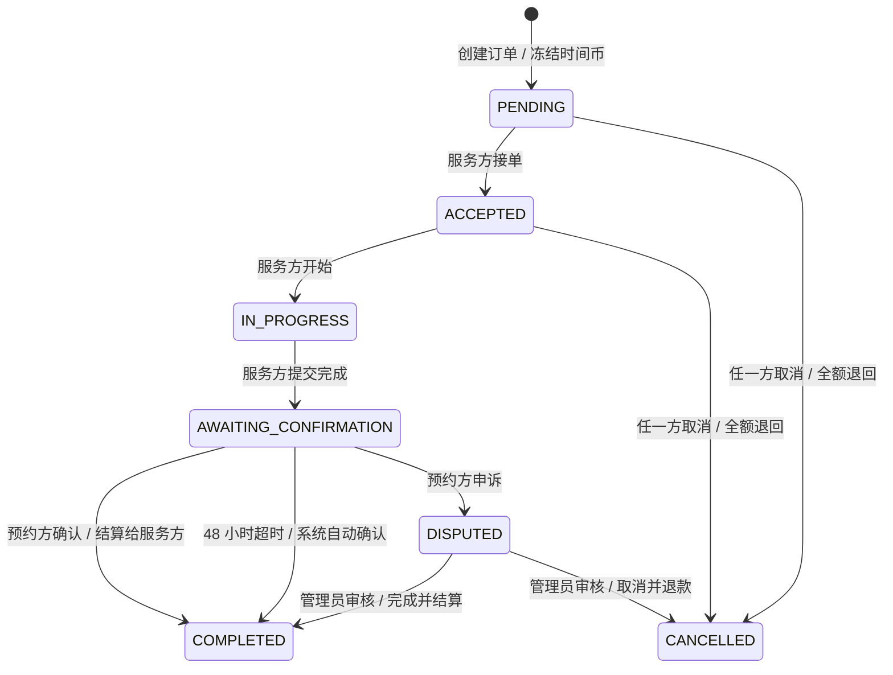
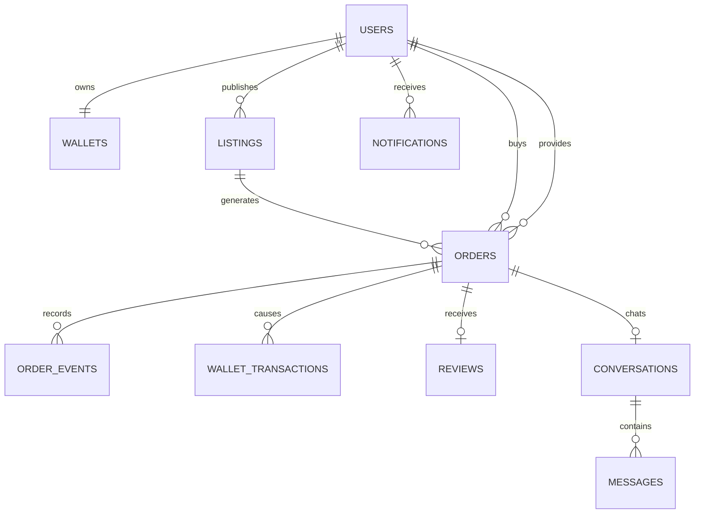

# 时光集市 · 校园技能与时间互换平台

一个面向高校学生的 C2C 技能互助 Web 项目。学生既可以发布自己能提供的技能，也可以发布需求；每小时服务统一结算 1 枚时间币。平台通过订单状态机、时间币冻结/结算、WebSocket 私信和个性化推荐，把“技能发布”到“完成评价”串成完整闭环。

当前仓库已经是一个可运行、可演示的课程 MVP，不是只有目录和页面稿。

## 已实现功能

- 用户注册、登录、JWT 身份认证和个人资料编辑
- 提供技能 / 发布需求、关键词搜索、分类筛选和排序
- 技能作品集最多上传 6 张图片，并支持个人头像上传
- 技能帖编辑、暂停、关闭、图片排序和审核下架状态
- 技能收藏、取消收藏和浏览足迹
- 预约时间冲突检测：同时检查预约方与服务方的重叠日程
- 可视化 7 天预约日历：忙碌时段自动禁用，可切换下一周
- 订单创建、接单、开始服务、提交完成、确认完成、取消和申诉
- 服务提交后 48 小时未确认，由系统自动完成并结算
- 服务开始前 24 小时、1 小时向双方发送预约提醒
- 管理员申诉审核：完成结算或成立退款，并保留审核说明
- 时间币钱包：新用户赠送 3 币、订单冻结、取消退款、完成结算、流水记录
- WebSocket 实时私信、消息持久化、未读数、正在输入提示
- 持久化通知中心：订单状态、申诉结果和收到评价实时提醒
- 基于历史订单、个人介绍、评分和热度的推荐排序
- 收藏、浏览分类行为会参与推荐评分
- 预约方和服务方可以互相评价，评分分别汇总到用户主页
- 技能帖和用户举报、管理员内容审核与违规内容下架
- 公开用户主页：技能、评价、完成次数和校园信息
- 统一管理员工作台：待办总览、交易申诉、内容审核、审计记录和系统状态
- 响应式前端，桌面端和移动端布局
- 订单状态机单元测试和全链路 API/WebSocket 冒烟测试

## 技术栈

| 层级 | 技术 |
| --- | --- |
| 前端 | Vue 3、TypeScript、Vite、Vue Router |
| 后端 | Node.js、Express 5、TypeScript |
| 实时通信 | `ws` / WebSocket |
| 数据存储 | SQLite（`node:sqlite`），无需单独安装数据库 |
| 身份认证 | JWT + Node `scrypt` 密码哈希 |
| 校验与测试 | Zod、Vitest |

选择 SQLite 是为了让课程演示开箱即用。业务 SQL 没有绑定前端，后续可迁移到 MySQL/PostgreSQL；实时消息和推荐缓存可再接入 Redis。

## 快速启动

环境要求：Node.js 22.5+，推荐 Node.js 24。

```bash
npm install
npm run dev
```

打开 <http://localhost:5173>。开发模式下 Vite 会把 `/api` 和 `/ws` 代理到 `http://localhost:3000`。

演示账号的密码均为 `123456`：

| 邮箱 | 角色 |
| --- | --- |
| `lin@campus.edu` | 设计学院学生，提供妆造 / 约拍 |
| `chen@campus.edu` | 计算机学院学生，提供电脑维修 |
| `zhou@campus.edu` | 数学系学生，提供高数辅导 |
| `song@campus.edu` | 新闻系学生，提供校园摄影 |
| `admin@campus.edu` | 管理员，处理订单申诉 |

生产式本地运行：

```bash
npm run build
npm start
```

随后访问 <http://localhost:3000>。Express 会同时提供 API 和构建后的前端。

## 常用命令

```bash
npm run dev          # 同时启动 API 和前端开发服务器
npm run build        # 类型检查并构建前后端
npm test             # 订单状态机单元测试
npm run smoke        # 对已启动的服务执行完整业务冒烟测试
```

`npm run smoke` 会真实创建已完成订单、取消退款订单和管理员申诉退款订单，并通过两个 WebSocket 客户端发送消息。建议在演示前执行一次。

## 项目结构

```text
.
├─ client/
│  └─ src/
│     ├─ components/          # 通用技能卡片、头像
│     ├─ views/               # 首页、广场、详情、订单、聊天、个人中心
│     ├─ api.ts               # HTTP 客户端
│     ├─ store.ts             # 登录态与钱包状态
│     └─ router.ts            # 页面路由与登录守卫
├─ server/
│  └─ src/
│     ├─ domain/              # 纯业务状态机与单元测试
│     ├─ routes/              # REST 接口
│     ├─ services/            # 订单、聊天、搜索、推荐业务
│     ├─ realtime/            # WebSocket 连接管理和消息推送
│     ├─ security/            # 密码哈希
│     ├─ db.ts                # 表结构、事务封装和演示数据
│     └─ app.ts               # Express 应用组装
├─ scripts/smoke.mjs          # 全链路验收脚本
└─ docs/                      # 架构和接口说明
```

项目验收展示入口：<http://localhost:3000/presentation>。8 分钟展示脚本见 [验收展示提纲](docs/PRESENTATION.md)。

管理员入口：<http://localhost:3000/admin>。权限边界和审核流程见 [管理员工作台说明](docs/ADMIN.md)。

更详细的模块关系、资金一致性策略和数据库设计见 [架构说明](docs/ARCHITECTURE.md)，接口与 WebSocket 协议见 [接口说明](docs/API.md)。

## 订单状态机



状态变化只由 `orderStateMachine.ts` 中的规则决定。角色权限、当前状态和目标状态三层校验通过后，订单更新、状态事件和钱包结算才会进入同一个数据库事务。

## 核心数据表



订单事件表保留每次状态变化，钱包流水保留每次冻结、退款和收入，方便展示订单时间轴，也避免只依赖最终余额排查问题。

## 推荐算法

当前推荐采用可解释的加权排序，适合作为课程项目的基线：

```text
score = 历史同类订单次数 × 18
      + 收藏同类技能数 × 14
      + 浏览同类技能次数 × 3
      + 个人介绍关键词命中数 × 9
      + 服务者评分 × 4
      + 服务完成数 × 0.2
      + 新帖时间衰减分
```

每条推荐会附上“为什么推荐”的原因。后续可以积累浏览、点击、收藏和完成数据，再升级为协同过滤或向量召回。

## 可继续扩展的方向

1. 把 SQLite 数据访问迁移为 Prisma / TypeORM + MySQL，并补数据库迁移脚本。
2. 接入 Redis 保存在线状态、验证码、消息队列与推荐缓存。
3. 扩展管理员后台：增加用户封禁、信任等级和运营统计图表。
4. 增加可视化周历、预约提醒和用户自定义空闲时段。
5. 将本地上传迁移到对象存储，并增加图片裁剪、压缩和内容审核。
6. 增加基于用户行为的协同过滤推荐和搜索同义词。
7. 增加限流、审计日志、接口文档生成和端到端测试。

## 课程答辩可强调的亮点

- 时间币不是直接余额扣减，而是“冻结 → 结算 / 退款”的两阶段流程。
- 订单状态机是独立纯函数，可单测，且接口层、数据库层共同拒绝非法状态迁移。
- 所有资金与状态写入使用事务，并保留可追踪的事件和流水。
- 申诉审核使用数据库角色校验，管理操作仍复用原有结算和退款事务。
- 通知持久化并通过 WebSocket 推送，断线后仍能在通知中心查看。
- 时间区间按半开区间检测重叠，待接单订单也占用双方日程。
- 自动确认由后台任务触发，并通过条件更新保证同一订单只结算一次。
- 双向评价按 `(订单, 作者)` 唯一约束落库，避免同一方重复评价。
- 内容审核下架使用独立 `blocked_at` 标记，普通用户不能通过编辑页重新上架。
- WebSocket 不是只做前端演示，消息会鉴权、持久化，再实时推送。
- 推荐结果有明确原因，算法参数和冷启动策略可以解释。

