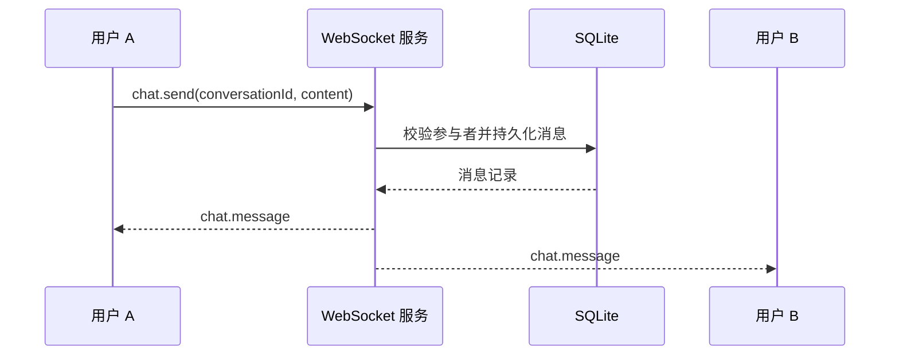

# 架构说明

## 1. 总体结构

项目采用前后端分离、单仓库组织：

```text
浏览器
  ├─ Vue Router：页面与登录守卫
  ├─ fetch：REST 请求
  └─ WebSocket：实时私信
          │
          ▼
Express 应用
  ├─ Route：参数校验、身份认证、返回 DTO
  ├─ Service：业务规则、事务、跨表操作
  ├─ Domain：纯订单状态机
  ├─ Realtime：连接注册与消息推送
  └─ SQLite：用户、帖子、订单、钱包、评价、会话
```

路由层不直接计算订单状态；状态转换放在 `server/src/domain/orderStateMachine.ts`。服务层负责把状态规则、角色权限、钱包变化写入同一个事务。

## 2. 模块职责

| 模块 | 责任 |
| --- | --- |
| `auth.ts` | JWT 签发、HTTP 鉴权 |
| `realtime/websocket.ts` | WebSocket 握手鉴权、消息事件处理 |
| `realtime/chatHub.ts` | 用户到 Socket 集合的映射、推送 |
| `listingService.ts` | 搜索、筛选、发布者信息组装 |
| `recommendationService.ts` | 可解释推荐评分 |
| `orderService.ts` | 订单创建、状态动作、评价、钱包结算 |
| `chatService.ts` | 会话创建、权限判断、消息持久化 |
| `notificationService.ts` | 通知持久化、未读统计与实时推送 |
| `adminService.ts` | 运营指标和申诉队列 |
| `jobs/orderAutomationWorker.ts` | 扫描超时订单并发送预约提醒 |
| `uploadRoutes.ts` | 图片大小、格式、文件头校验和本地存储 |
| `listingInteractionService.ts` | 收藏、浏览足迹和图片归属校验 |
| `reportService.ts` | 举报创建、管理员审核和违规内容下架 |
| `db.ts` | 表结构、数据库工具、事务和演示数据 |

## 3. 订单一致性设计

### 3.1 创建订单

在同一个事务中执行：

1. 检查技能帖状态和预约者身份。
2. 校验预约方余额。
3. 从预约方可用余额扣除，并加入冻结余额。
4. 写入订单主表。
5. 写入钱包流水和订单事件。
6. 自动创建双方会话。

任何一步失败都会回滚，不会出现“币已扣但订单未创建”。

### 3.2 完成订单

仅允许预约方在 `AWAITING_CONFIRMATION` 状态确认完成。同一事务内：

1. 更新订单状态。
2. 写入状态变化事件。
3. 清除预约方冻结余额，增加累计使用。
4. 增加服务方可用余额和累计收入。
5. 增加服务方完成次数。
6. 写入服务方收入流水。

### 3.3 取消订单

仅允许 `PENDING` 和 `ACCEPTED` 状态取消。取消时清除冻结余额并退回可用余额，同时记录退款流水。进入服务中以后不能直接取消，避免已经付出的时间无法确认。

### 3.4 并发控制

- 更新钱包时带有 `available >= amount` 或 `frozen >= amount` 条件。
- 更新订单时带有 `WHERE id = ? AND status = ?`。
- `changes !== 1` 时抛出冲突并回滚。
- SQLite 事务使用 `BEGIN IMMEDIATE`。

迁移到 MySQL 后建议把钱包更新条件保留，并使用行锁或乐观版本号；消息和通知可进一步异步化。

### 3.5 申诉审核

申诉只能由预约方从 `AWAITING_CONFIRMATION` 发起，进入 `DISPUTED` 后普通订单动作全部停止。管理员必须先从数据库校验 `ADMIN` 角色，然后选择：

- `RELEASE`：管理员确认服务有效，进入 `COMPLETED` 并执行正常的服务方结算。
- `REFUND`：管理员确认申诉成立，进入 `CANCELLED` 并执行正常的预约方退款。

审核动作和说明会写入 `order_events`，并通知订单双方。管理员接口不能跳转到任意状态，仍受申诉状态机约束。

### 3.6 日程冲突与超时确认

创建订单前，服务端会检查预约方和服务方的已有订单。`PENDING`、`ACCEPTED`、`IN_PROGRESS`、`AWAITING_CONFIRMATION` 和 `DISPUTED` 都视为占用日程，已完成和已取消订单不占用。区间采用 `[开始时间, 结束时间)`，因此上一项服务在 12:00 结束、下一项在 12:00 开始时不会误判为冲突。

服务方提交完成后，订单写入 `auto_confirm_at = 提交时间 + 48 小时`。后台任务每分钟扫描到期订单，并以系统账户写入 `AUTO_CONFIRM` 事件、结算时间币、通知双方。更新语句同时限制订单状态和到期时间，保证重复扫描不会重复结算。

预约日历接口只返回忙碌区间和冲突角色，不向第三方泄露其他订单的标题、金额或参与者。前端根据本地时区生成 09:00 至 20:00 的 hourly slot，再把本地时间序列化为 UTC 后交给后端校验，避免服务器时区与浏览器时区不一致。

提醒任务优先处理 1 小时提醒，再处理 24 小时提醒。`order_reminders` 上的 `(order_id, type)` 唯一约束保证任务重复执行时不会重复发送；提醒会同时进入持久化通知中心和 WebSocket 推送。

可通过环境变量调整演示参数：

```env
AUTO_CONFIRM_HOURS=48
AUTO_CONFIRM_INTERVAL_MS=60000
```

## 4. 身份与权限

- 密码使用 Node `scrypt` 加随机盐哈希，不保存明文。
- JWT 有效期 7 天，HTTP 使用 `Authorization: Bearer <token>`。
- WebSocket 在握手 URL 中携带 token，服务端验证后才接受连接。
- 订单详情、订单动作、会话和消息都会校验当前用户是否为参与者。
- 服务方可以接单、开始、提交完成；预约方可以确认完成和申诉。
- 管理员接口在 JWT 鉴权之外再次查询数据库角色，普通用户无法仅通过修改前端进入审核接口。

生产环境应把 JWT 放入 HttpOnly Cookie，增加刷新 token、CSRF 防护、登录限流和密码找回。

## 5. WebSocket 消息流



连接映射只保存在当前进程内，适合单机课程项目。多实例部署时应使用 Redis Pub/Sub 或专门消息网关广播。

订单状态变化、申诉审核和评价会写入 `notifications`。如果用户在线，会收到 `notification.new` 事件；如果离线，用户下次进入通知中心时仍可查看完整记录。

## 6. 推荐冷启动

新用户没有历史订单时，主要依据个人介绍关键词、服务者评分、完成次数和新帖程度。用户产生行为后，同分类收藏权重为 14，浏览权重为 3，历史订单权重为 18。每个 DTO 都包含 `recommendationReason`，用于前端展示和答辩解释。

## 7. 图片与用户行为

- 技能图片最多 6 张、单张 5MB，只接受 JPG、PNG 和 WebP。
- 服务端同时检查 MIME 类型和文件头，不能只通过伪造扩展名上传。
- 上传文件使用随机文件名，记录到 `uploaded_assets`，发布技能或更换头像时校验资产属于当前用户。
- 技能无图片时保留原有渐变分类封面，不影响旧数据。
- 浏览记录按用户和技能聚合，详情页每次访问累加个人浏览次数。
- 收藏和浏览只使用分类做推荐聚合，不会向其他用户公开。

## 8. 内容治理与帖子生命周期

- 技能帖状态包括展示中、暂停和关闭；被管理员审核关闭时额外写入 `blocked_at`。
- 被审核下架的内容不会出现在搜索、收藏和浏览足迹中，普通用户也不能通过编辑接口恢复。
- 技能帖所有者可以编辑标题、描述、时间、地点、图片和展示状态，历史订单继续保留。
- 图片顺序由数组顺序决定，第一张为卡片和详情页封面。
- 举报只对登录用户开放，同一用户不能重复提交同一对象的待处理举报。
- 内容审核和违规下架使用数据库事务，并向举报人、内容所有者发送处理结果通知。

双方评价使用 `UNIQUE(order_id, author_id)`。预约方评价服务方，服务方评价预约方，两条评价会分别计入目标用户的评分汇总。

## 9. 安全与生产化清单

课程演示版本已实现密码哈希、JWT、输入校验、参与者权限和 SQL 参数绑定。正式上线还需要：

- 使用 HTTPS 和 HttpOnly Cookie。
- 对登录、注册、发帖和发消息增加速率限制。
- 把默认 JWT 密钥替换为安全环境变量。
- 使用数据库迁移工具管理表结构。
- 上传内容做类型、大小和恶意文件校验。
- 当前本地文件上传适合课程演示，正式部署应迁移至对象存储并接入内容审核。
- 增加管理员申诉流程和审计日志。
- 增加备份、监控、错误追踪和依赖漏洞扫描。

